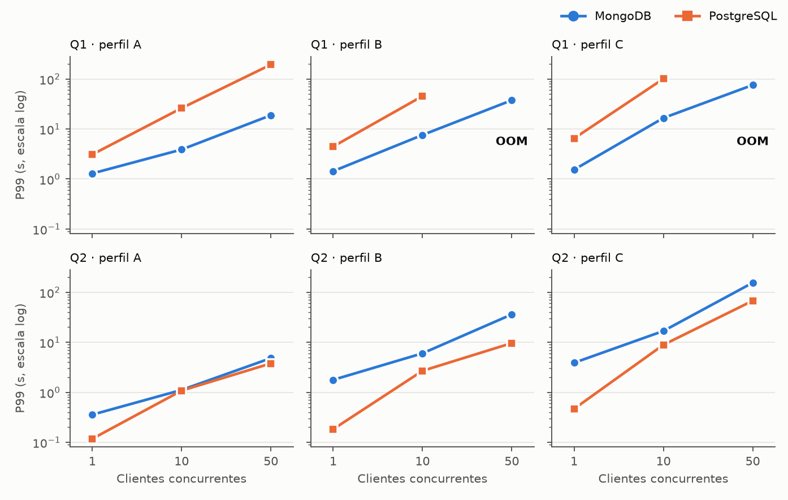
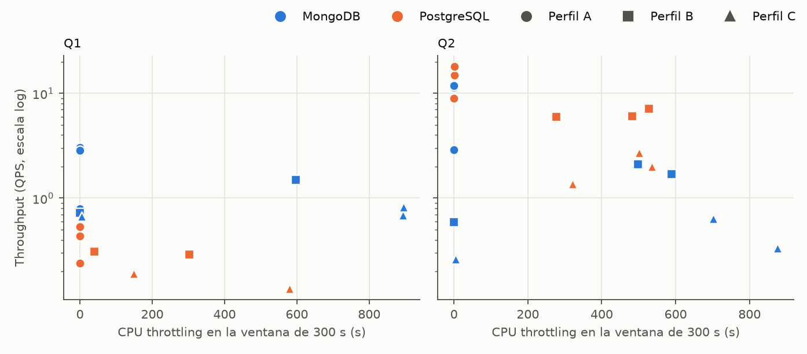
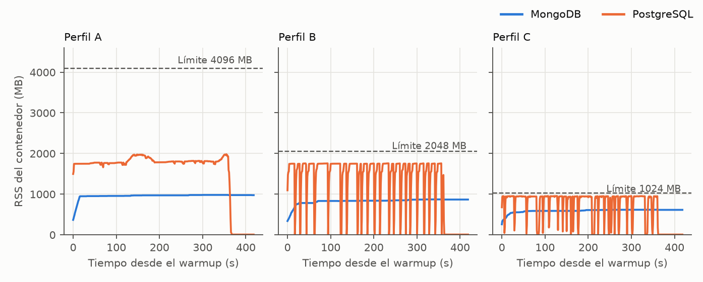

# Medición de métricas en bases documentales

**Contención de CPU y memoria en agregaciones JSON: MongoDB frente a PostgreSQL JSONB**

Universidad Politécnica de Chiapas · IT2iD · Bases de Datos en la Nube · 2026

## Resumen

Se ejecutaron 108 corridas sobre 500 000 documentos (36 celdas con 3 repeticiones), en 14.1 horas y sin incidencias. Con ellas se responden las tres preguntas de la actividad:

- **M1, latencia de cola.** El P99 empeora hasta 32 veces en MongoDB y 18 veces en PostgreSQL al pasar del perfil A al C. PostgreSQL Q1 no termina con 50 clientes en los perfiles B y C.
- **M2, buffers.** Ningún motor gana en todo. MongoDB agrupa Q1 en memoria mínima, pero su caché se satura en Q2. PostgreSQL resuelve Q2 en 273 kB, pero Q1 vuelca 704 MB a disco y termina en OOM con 50 clientes.
- **M3, huella.** En Q1 MongoDB gasta cerca de 2.4–3.0 ms de CPU por 1000 documentos y PostgreSQL 6.7–15.3 ms. En Q2 ocurre lo contrario: PostgreSQL 0.4–1.4 ms y MongoDB 1.5–16.8 ms.

## 1. Especificaciones del host y del entorno Docker

| Componente | Valor |
|---|---|
| CPU | AMD Ryzen 5 5500X3D, 6 núcleos y 12 hilos |
| Memoria | 15 GiB; zram de 15.5 GiB como swap del host |
| Sistema | Linux 7.3.0-4-cachyos, x86_64 |
| Docker | Engine 29.9.2, Compose 5.6.1, cgroups v2, driver systemd |
| MongoDB | 9.0.4, WiredTiger, colección `orders` sin sharding |
| PostgreSQL | 18.6, tabla `orders (id UUID PRIMARY KEY, data JSONB)` |
| Telemetría | cAdvisor 0.60.6, Node Exporter 1.12.1, Prometheus 3.15.1 con scrape de 1 s |
| Runner | Python 3.12 multiproceso, en bucle cerrado sin think time |

La salida completa y los digests de las imágenes están en `results/host_spec.txt`.

**Aislamiento.** Los motores corrieron en los CPUs 0-3, y el runner y la telemetría en 4, 5, 10 y 11. Los hermanos SMT 6-9 quedaron libres. El cpuset es igual en los tres perfiles, de modo que el límite lo impone la cuota CFS. Solo un motor estuvo activo a la vez, con el governor en `performance`.

**Límites comprobados en el cgroup de cada contenedor:**

| Perfil | `cpu.max` | `memory.max` | `memory.swap.max` | Caché WiredTiger | `shared_buffers` |
|---|---|---|---|---|---|
| A | 400000 100000 | 4 GiB | 0 | 1536 MB | 1 GB |
| B | 200000 100000 | 2 GiB | 0 | 512 MB | 512 MB |
| C | 100000 100000 | 1 GiB | 0 | 256 MB | 256 MB |

**Ajustes respecto al playbook:**

| Ajuste | Motivo |
|---|---|
| `mem_swappiness` no se aplicó | No existe en cgroups v2. Se evitó el swap con `memswap_limit` igual a `mem_limit` |
| `shared_buffers` al 25 % del límite | WiredTiger se ajusta al cgroup y PostgreSQL no. El OOM también ocurre con los 128 MB de fábrica |
| `shm_size` de 1 GiB | Los 64 MB por defecto pueden romper consultas paralelas |
| Filtro de Q2 por texto ISO-8601 | El cast a `timestamptz` no se puede indexar. Devuelve las mismas 181 307 filas que la query original |
| Reinicio del motor en cada corrida | `drop_caches` no vacía la caché de WiredTiger ni `shared_buffers` |
| RSS leído de `container_memory_rss` | `container_memory_rss_bytes` no existe en cAdvisor |
| Runner en Python | k6 no incluye drivers nativos de MongoDB ni de PostgreSQL |
| Sin healthchecks en los motores | Consumirían CPU dentro del cgroup medido |

## 2. Método de medición y verificación del baseline

**Dataset.** 500 000 documentos generados con `synthetic_data_generator.py` y semilla 42, con 3 niveles de anidamiento, 3.0 ítems por orden y 1114 bytes de media. Regenerarlo produjo el mismo SHA-256 (`9cd202a6e102ad8e97eb…`), registrado en `docs/dataset_manifest.json`.

**Ciclo de cada corrida:** apagar los motores, `sync; echo 3 > /proc/sys/vm/drop_caches`, levantar el motor con su perfil, 60 s de warmup, 300 s de medición y 60 s de cooldown. Las corridas se barajaron con semilla fija, en bloques por repetición.

**Cálculo de métricas:**

- Cuentan las consultas que terminan dentro de la ventana de 300 s. Las que siguen en curso al cerrar se cancelan y no cuentan.
- Los percentiles usan interpolación lineal sobre las latencias de cada corrida.
- Las 3 repeticiones se resumen con la **mediana**.
- `cpu_throttled_seconds` es el delta del contador en la ventana, verificado contra `cpu.stat` del cgroup.
- `max_rss_mb` es el máximo de la serie de `container_memory_rss`.

**Verificación del baseline:**

- Throttling máximo en el perfil A: 1.49 s, frente a 970 s en el peor caso del perfil C.
- Mismo dataset: conteos y agregados idénticos tras la carga.
- Mismas queries: Q1 devuelve los mismos 96 grupos en ambos motores y Q2 los mismos 1000 pedidos.
- Todas las corridas tuvieron al menos 299 muestras de Prometheus, y ninguna incidencia de infraestructura.
- El manifiesto SHA-256 de queries, perfiles, compose y dataset no cambió durante la campaña.

**Alcance de Q2.** El CSV oficial usa la variante restrictiva (`allowDiskUse:false`, `work_mem=4MB`) porque no tiene columna de variante. Las 108 corridas de las 36 celdas son la matriz que define el playbook, que indica que las variantes de Q2 no están incluidas en ese conteo, y con ellas se calculan todas las métricas de este reporte.

La segunda variante (`allowDiskUse:true`, `work_mem=64MB`) se corrió en las 18 celdas de Q2 **solo con fines de aprendizaje**, para completar el ejercicio. Sus 54 corridas van en `results/anexo_q2_variantes.csv`, fuera del CSV oficial, y no intervienen en las respuestas a M1, M2 y M3.

## 3. Resultados consolidados

Mediana de 3 repeticiones. `n` es el número de consultas completadas en la ventana, también en mediana. "n/d" indica que no hubo consultas completadas.

{{tabla:resultados}}

**Efecto de la contención sobre el P99:**

{{tabla:contencion}}

Q1 en MongoDB escala casi exactamente con la CPU: con 10 clientes da 3.03, 1.48 y 0.69 QPS en los perfiles A, B y C. Q2 en MongoDB cae mucho más que la CPU disponible, de 11.43 a 2.10 QPS entre A y B, por la causa que explica la sección 6.

**Huella por cada 1000 documentos (M3).** El CSV no incluye CPU consumida, así que se calculó con `cpu_seconds` de `results/raw/`. Una ejecución de Q1 lee 500 000 documentos en ambos motores. Q2 lee 226 680 en MongoDB y 500 000 en PostgreSQL.

{{tabla:huella}}

## 4. Análisis gráfico



**Figura 1.** P99 frente a concurrencia. En Q1, PostgreSQL es peor en todos los casos y no completa consultas con 50 clientes en B y C. En Q2 la relación se invierte y la distancia crece al reducir recursos.



**Figura 2.** Throttling frente a QPS, una marca por celda. Se excluyen las dos celdas sin consultas completadas. El throttling suma tiempo de todos los hilos, así que puede superar los 300 s de la ventana. No hay una relación única: en MongoDB Q1 el throttling alto apenas reduce el QPS con 1 CPU, mientras que PostgreSQL Q1 tiene un QPS bajo aun sin throttling, algo coherente con el costo de su spill.



**Figura 3.** RSS durante Q1 con 50 clientes, primera repetición. MongoDB se estabiliza por debajo del límite. PostgreSQL llega a unos 2 GB en el perfil A, sin límite que lo detenga. En B y C el diente de sierra muestra cada caída por OOM y su reinicio.

## 5. Planes de ejecución

Se capturaron con `explain('executionStats')` y `EXPLAIN (ANALYZE, BUFFERS)` fuera de la ventana medida, uno por motor, perfil y query (`results/explain/`).

| | MongoDB | PostgreSQL |
|---|---|---|
| **Q1, acceso** | COLLSCAN de 500 000 documentos | Parallel Seq Scan con 2 workers |
| **Q1, agrupación** | `$group`; `usedDisk: false` | Sort seguido de GroupAggregate |
| **Q1, memoria** | Picos de unos 64 kB | `external merge` por 704 MB en disco |
| **Q2, acceso** | IXSCAN + FETCH de 226 680 documentos | Parallel Seq Scan con 2 workers |
| **Q2, orden** | Top-K; pico de 1.3 MB; `usedDisk: false` | Top-N heapsort de 273 kB |
| **Q2, tiempo A / B / C** | 1.6 / 3.0 / 5.0 s | 0.47 / 0.48 / 0.59 s |

**Los planes respaldan los cuellos de botella:**

- **PostgreSQL Q1.** El planificador asume 16.5 millones de filas tras `jsonb_array_elements`, cuando en realidad hay 644 159. Con esa estimación elige un plan basado en ordenar, y antes de desanidar `items` ordena los 500 000 documentos completos (ancho estimado de 1460 bytes). De ahí salen los 704 MB, y por eso `work_mem` no lo resuelve.
- **MongoDB Q2.** El índice de `timestamp` cubre el 45 % de la colección, y leer esos documentos en orden de índice obliga a lecturas dispersas. PostgreSQL prefiere recorrer la tabla, y sus tiempos casi no cambian entre perfiles.

## 6. Interpretación: límites de memoria, volcado a disco y throttling de cgroups

### OOM

PostgreSQL Q1 terminó en OOM en las 6 corridas con 50 clientes de los perfiles B y C. No es un efecto de la configuración: también ocurre con `shared_buffers` de fábrica. Con 4 GiB sobrevive, con un RSS máximo de 1980 MB. En el perfil B llegó a 1770 MB de RSS, a los que se suman hasta 512 MB de `shared_buffers`, que no cuentan en RSS. Los 120 procesos muertos registrados tenían una mediana de 26 MB de memoria anónima: el consumo crece con cada cliente, porque `work_mem` limita cada operación de ordenamiento y no el total del motor.

Evidencia de `results/raw/postgresql-C-Q1-c50-r1/oom_evidence.log`, con 229 eventos del kernel en esa corrida:

```text
kernel: Memory cgroup out of memory: Killed process 510344 (postgres) anon-rss:21596kB
LOG: client backend (PID 69) was terminated by signal 9: Killed
```

MongoDB no tuvo ningún OOM. Su RSS mediano más alto fue de 979 MB.

### Volcado a disco

| Carga | Corridas con spill |
|---|---|
| PostgreSQL Q1 | 27 de 27 |
| PostgreSQL Q2 | 0 de 27 |
| MongoDB Q1 y Q2 | 0 de 54 |
| Anexo de aprendizaje, segunda variante de Q2 | 0 de 54 |

En PostgreSQL Q1 el contenedor escribió hasta 54 GB por corrida. Subir `work_mem` **no** elimina el problema: en una sonda de una ejecución, el plan siguió usando `external merge` con 64 MB (721 MB en disco) y con 256 MB (515 MB).

Q2 no hace spill porque ambos motores conservan solo 1000 filas. Era un riesgo previsto, y limita el valor de Q2 como prueba de estrés de buffers. Como sonda, se ejecutó Q2 **sin LIMIT** en el perfil C:

- PostgreSQL pasó de `external merge` con 4 MB a `quicksort` en memoria con 64 MB.
- MongoDB tampoco hizo spill: el sort ocupó 31.9 MB de los 100 MB permitidos, porque solo retiene los campos necesarios.

Por tanto, **no se observó spill en MongoDB en ninguna prueba**. Tampoco se pudo provocar el error por `allowDiskUse:false`.

### Saturación de caché

MongoDB Q2 consume 11 veces más CPU por documento en el perfil C que en el A. La colección ocupa 571 MB sin comprimir. Si cabe en caché, una segunda ejecución no toca disco; si no, cada ejecución vuelve a leer páginas varias veces:

| Perfil | Caché WiredTiger | Releído en la 2.ª ejecución | Tiempo |
|---|---|---|---|
| A | 1536 MB | 0 MB | 0.35 s |
| B | 512 MB | 3485 MB | 1.69 s |
| C | 256 MB | 9121 MB | 3.85 s |

### Throttling CFS

El throttling fue prácticamente nulo en el perfil A y llegó a 970 s en el C. MongoDB ejecuta cada consulta en un hilo, por lo que con 1 cliente casi no alcanza la cuota: 4.5 s en Q1 con perfil C. PostgreSQL usa 2 workers paralelos y sí la agota, con 148 s en el mismo caso.

**Respuesta a M2.** PostgreSQL es más eficiente cuando el Top-K o el recorrido secuencial evitan retener datos, pero muy frágil cuando debe ordenar documentos anchos. MongoDB es más estable en memoria y nunca falló, pero depende de que su conjunto de trabajo quepa en caché.

### Limitaciones

- **Un solo host y 3 repeticiones.** Los resultados valen para este entorno.
- **Pocas muestras en celdas pesadas.** El mínimo es n = 41 (PostgreSQL Q1, C con 10 clientes), así que ahí P99 casi equivale al máximo.
- **RSS no es del todo comparable.** `shared_buffers` cuenta como memoria compartida y no entra en RSS, mientras que la caché de WiredTiger sí entra. PostgreSQL aparece con menos memoria de la real.
- **La CPU de escritura no se contabiliza.** El kernel escribe el spill fuera del cgroup, así que la huella de PostgreSQL Q1 está subestimada.
- **Detector de ruido.** 6 corridas de PostgreSQL Q1 (perfil A, 10 y 50 clientes) se marcaron por ruido y se repitieron. Las repeticiones dieron valores casi iguales: la causa fue esa escritura del kernel, no actividad externa. Se conservaron como válidas.
- **`disk_spill` en celdas con OOM.** El reinicio borra los contadores, por lo que se infiere de las escrituras del contenedor con una carga de solo lectura. El plan confirma el `external merge`.
- **Paralelismo.** PostgreSQL puede usar varios procesos por consulta y MongoDB no; no se ajustó para igualarlos.
- **Sondas.** Son de una sola ejecución y sirven para explicar, no para medir. Sus tiempos en PostgreSQL mezclan caché fría y caliente.

## 7. Recomendaciones técnicas para despliegues documentales en la nube

1. **Dimensionar memoria por concurrencia y no por tamaño de datos.** Un dataset de 531 MB derribó a PostgreSQL con 2 GiB. Conviene limitar conexiones activas, por ejemplo con un pool, y calcular el consumo con unos 40 MB de RSS por cliente, la referencia medida en esta carga.
2. **No confiar en `work_mem` para agregaciones sobre JSONB.** Antes de subirlo, revisar `EXPLAIN`: la estimación de `jsonb_array_elements` y el ordenamiento de documentos completos causan el problema. Extraer primero solo los campos necesarios debería reducirlo, aunque aquí no se midió.
3. **Dimensionar la caché de WiredTiger según el conjunto de trabajo.** Con 256 MB y una colección de 571 MB, el costo por documento se multiplicó por 11. Si la instancia es pequeña, conviene evitar lecturas dispersas de gran parte de la colección.
4. **Elegir el motor según la consulta.** Con recorridos y agrupaciones sobre arreglos anidados, MongoDB dio más QPS en todas las celdas y no falló. Con filtros y Top-K, PostgreSQL dio más QPS en todas las celdas, de 1.3 a 10 veces más.
5. **Reservar CPU para el paralelismo.** Con cuotas pequeñas, los workers de PostgreSQL agotan el periodo de CFS aun con un solo cliente. Conviene ajustar `max_parallel_workers_per_gather` al límite real.
6. **Vigilar `oom_kill` y no solo el estado del contenedor.** PostgreSQL se recupera y sigue arriba tras cada muerte de un proceso. El contador de `memory.events` da la magnitud real: 229 eventos en una sola corrida.
7. **Mirar percentiles y no solo promedios.** En PostgreSQL Q2, perfil C con 50 clientes, el P50 es de 40 s y el P99 de 67 s: esa cola no se ve en un valor medio.

## Anexo A: segunda variante de Q2, con fines de aprendizaje

Este anexo **no forma parte de la matriz de la práctica**. Las 36 celdas del playbook ya estaban completas, y el playbook aclara que las variantes de Q2 no entran en ese conteo. Las métricas y las respuestas a M1, M2 y M3 se calculan solo con las 108 corridas oficiales; estas 54 corridas se hicieron para completar el ejercicio.

Se usó `allowDiskUse:true` en MongoDB y `work_mem=64MB` en PostgreSQL, en las 18 celdas de Q2 y con 3 repeticiones. Las condiciones de medición fueron las mismas, y `results/mediciones.csv` conservó su SHA-256.

{{tabla:anexo}}

**Resultado:** las variantes no cambiaron el comportamiento de Q2.

- Las 54 corridas terminaron con estado `ok` y ninguna hizo spill.
- En 16 de las 18 celdas, QPS y P99 quedaron dentro del ±6 %.
- Hay dos excepciones, ambas con perfil C y 50 clientes, la celda más lenta de Q2 en cada motor: MongoDB dio 16 % más QPS y PostgreSQL 24 % menos P99. Con 3 repeticiones no bastan para atribuirlas a la variante.
- Los planes coinciden con los de la variante oficial: `top-N heapsort` en PostgreSQL y `usedDisk: false` en MongoDB.

Es lo esperado: ambos motores conservan solo 1000 filas, así que los buffers quedan muy por debajo de cualquiera de los dos límites.

## Anexo B: preguntas del revisor

| Pregunta | Respuesta |
|---|---|
| ¿El baseline es comparable? | Sí: mismo SHA-256 del dataset, mismos resultados y límites verificados (sección 2) |
| ¿Percentiles o promedios? | P50, P95 y P99 por corrida (sección 3) |
| ¿Hubo throttling CFS? | Sí, hasta 970 s en perfil C y 1.49 s como máximo en A (secciones 3 y 6) |
| ¿Spill u OOM? | Spill en PostgreSQL Q1 en todas las celdas; OOM en sus celdas B y C con 50 clientes (sección 6) |
| ¿Repeticiones y resumen? | 3 por celda, resumidas con la mediana (sección 2) |
| ¿El plan respalda el cuello de botella? | Sí: `external merge` en PostgreSQL Q1 e IXSCAN + FETCH en MongoDB Q2 (sección 5) |
